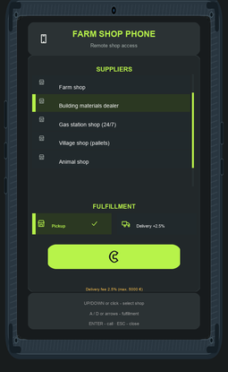

# Фермерский телефон — FS25 Farm Shop Phone

Мод добавляет в Farming Simulator 25 телефонный интерфейс для покупок на существующих торговых точках карты: обнаружение магазинов, выбор самовывоза или доставки к игроку, открытие штатного каталога FS25.

<table width="100%">
<tr>
<td valign="top" width="280">

</td>
<td valign="top">

<h2>Возможности</h2>

<ul>
<li>Клавиша <b>O</b> — открыть/закрыть телефон.</li>
<li>Обнаружение только реальных магазинов покупки — техника, паллеты, товары; пункты приёмки, продажи и мастерские отфильтровываются.</li>
<li>Триггерные точки открываются штатным каталогом <b>без телепортации игрока</b>.</li>
<li>Два способа получения: <b>самовывоз</b> и <b>доставка к игроку</b> с доплатой 2,5 % (максимум 5000). Плата за звонок — 10, списывается только при успешном открытии магазина.</li>
<li>Проверка места доставки: рельеф, уклон, вода, коллизии, отступ от игрока/машины.</li>
<li>Факт покупки подтверждается реальным созданием объекта; заказ завершается успехом только после завершения всех его загрузок.</li>
<li>Только одиночная игра.</li>
</ul>

</td>
</tr>
</table>

## Установка

1. Скачайте `.zip` из раздела [Releases](https://github.com/slept6999/FS25_FarmShopPhone/releases) и положите его целиком в папку `mods` (не распаковывать):
   - Windows: `Документы\My Games\FarmingSimulator2025\mods`
2. Включите **Фермерский телефон** в списке модов сохранения.
3. Нажмите **O** в игре.

Полная русская документация: [README_RU.md](README_RU.md), [docs/KNOWN_LIMITATIONS_RU.md](docs/KNOWN_LIMITATIONS_RU.md).

---

# Farm Shop Phone for FS25 (English)

The mod adds a phone interface to Farming Simulator 25 for buying at the existing map shops: shop discovery, pickup or delivery-to-player, and opening the original FS25 catalog.

<table width="100%">
<tr>
<td valign="top" width="280">

</td>
<td valign="top">

<h2>Features</h2>

<ul>
<li>Key <b>O</b> opens/closes the phone.</li>
<li>Only real purchase shops are discovered — vehicles, pallets, goods; buying/selling points and workshops are filtered out.</li>
<li>Trigger-based shops open the vanilla catalog <b>without teleporting the player</b>.</li>
<li>Two fulfillment methods: <b>pickup</b> and <b>delivery to the player</b> with a 2.5% surcharge (max. 5000). A phone-call fee of 10 is charged only when the store opens successfully.</li>
<li>Delivery spot validation: terrain, slope, water, collisions, clearance from the player/vehicle.</li>
<li>Purchase is confirmed by actual object creation; an order completes successfully only after all of its loads finish.</li>
<li>Single-player only.</li>
</ul>

</td>
</tr>
</table>

## Installation

1. Download the `.zip` from [Releases](https://github.com/slept6999/FS25_FarmShopPhone/releases) and place it as a whole into your `mods` folder (do not unpack):
   - Windows: `Documents\My Games\FarmingSimulator2025\mods`
2. Enable **Farm Shop Phone** in the savegame mod list.
3. Press **O** in game.
