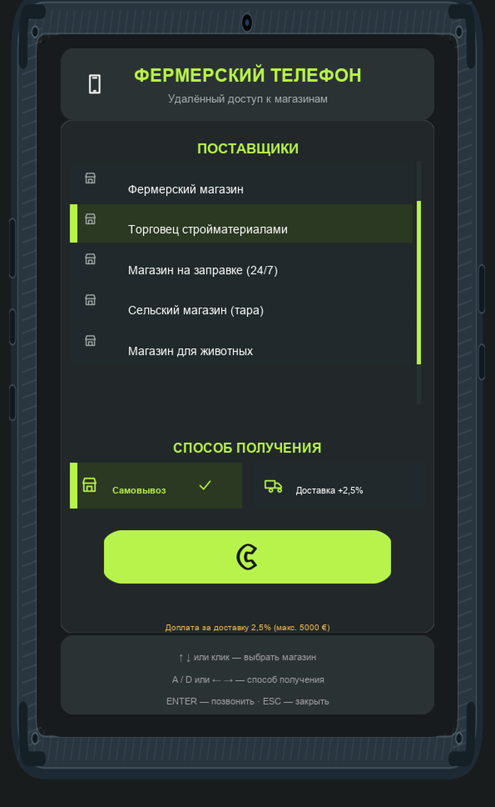

# Фермерский телефон — FS25 Farm Shop Phone

Версия **0.2.6.3**. Мод добавляет в Farming Simulator 25 телефонный интерфейс для покупок на существующих торговых точках карты: обнаружение магазинов, выбор самовывоза или доставки к игроку, открытие штатного каталога FS25.

## Возможности

- Клавиша **O** — открыть/закрыть телефон.
- Обнаружение только реальных точек покупки: `spec_vehicleBuyingStation`, `spec_palletBuyingStation`, `ShopTrigger` (пункты приёмки, продажи и мастерские отфильтровываются).
- Триггерные точки открываются штатным каталогом **без телепортации игрока**.
- Два способа получения: **самовывоз** и **доставка к игроку** с доплатой 2,5 % (максимум 5000). Плата за звонок — 10, списывается только при успешном открытии магазина.
- Проверка места доставки: рельеф, уклон, вода, коллизии, отступ от игрока/машины.
- Факт покупки подтверждается реальным созданием объекта; заказ завершается успехом только после завершения всех его загрузок.
- Только одиночная игра; мультиплеер отключён в `modDesc.xml`.

## Установка

1. Скачайте `.zip` из раздела [Releases](https://github.com/slept6999/FS25_FarmShopPhone/releases) и положите его целиком в папку `mods` (не распаковывать):
   - Windows: `Документы\My Games\FarmingSimulator2025\mods`
2. Включите **Фермерский телефон** в списке модов сохранения.
3. Нажмите **O** в игре.

Полная русская документация: [README_RU.md](README_RU.md), [docs/KNOWN_LIMITATIONS_RU.md](docs/KNOWN_LIMITATIONS_RU.md).

---

# Farm Shop Phone for FS25 (English)

Version **0.2.6.3**. The mod adds a phone interface to Farming Simulator 25 for buying at the existing map shops: shop discovery, pickup or delivery-to-player, and opening the original FS25 catalog.

## Features

- Key **O** opens/closes the phone.
- Only real purchase points are discovered: `spec_vehicleBuyingStation`, `spec_palletBuyingStation`, `ShopTrigger` (buying/selling stations and workshops are filtered out).
- Trigger-based shops open the vanilla catalog **without teleporting the player**.
- Two fulfillment methods: **pickup** and **delivery to the player** with a 2.5% surcharge (max. 5000). A phone-call fee of 10 is charged only when the store opens successfully.
- Delivery spot validation: terrain, slope, water, collisions, clearance from the player/vehicle.
- Purchase is confirmed by actual object creation; an order completes successfully only after all of its loads finish.
- Single-player only; multiplayer is disabled in `modDesc.xml`.

## Installation

1. Download the `.zip` from [Releases](https://github.com/slept6999/FS25_FarmShopPhone/releases) and place it as a whole into your `mods` folder (do not unpack):
   - Windows: `Documents\My Games\FarmingSimulator2025\mods`
2. Enable **Farm Shop Phone** in the savegame mod list.
3. Press **O** in game.
